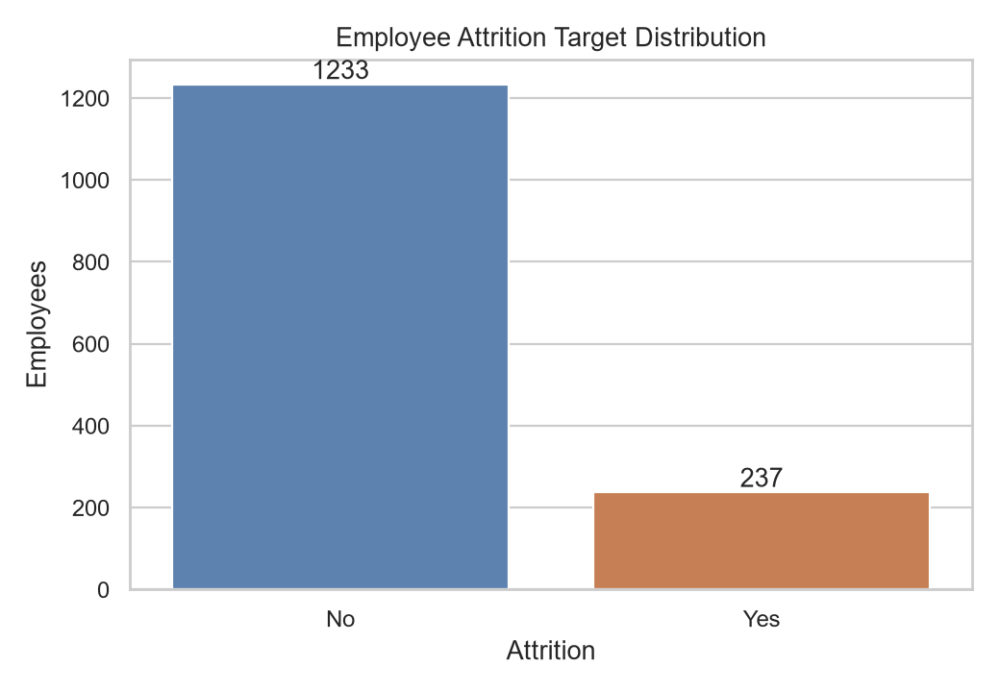
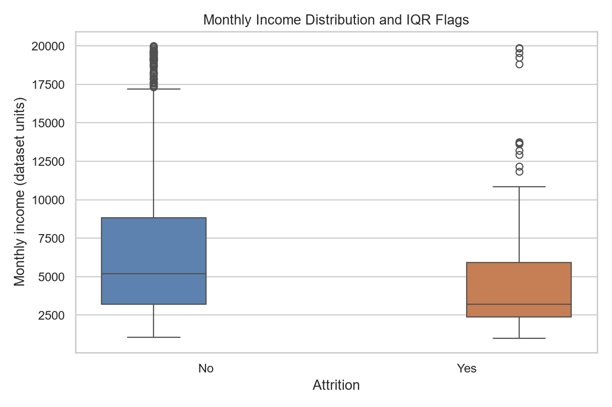
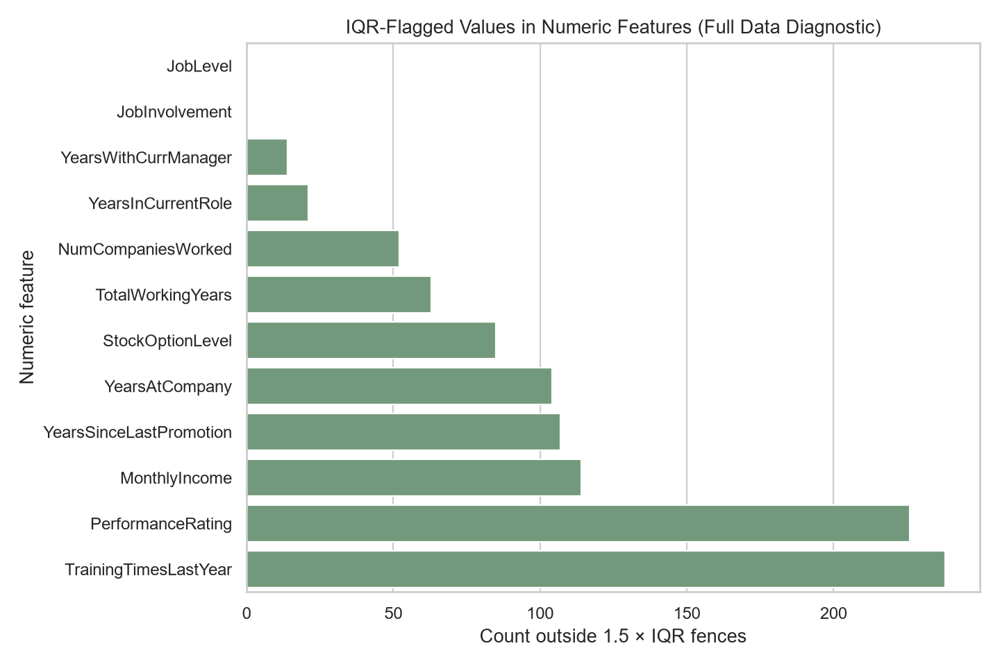
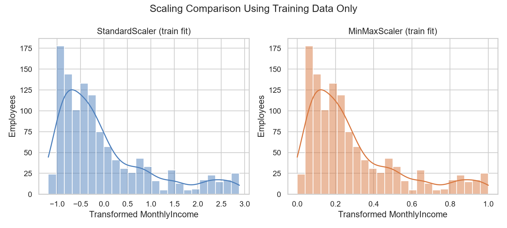
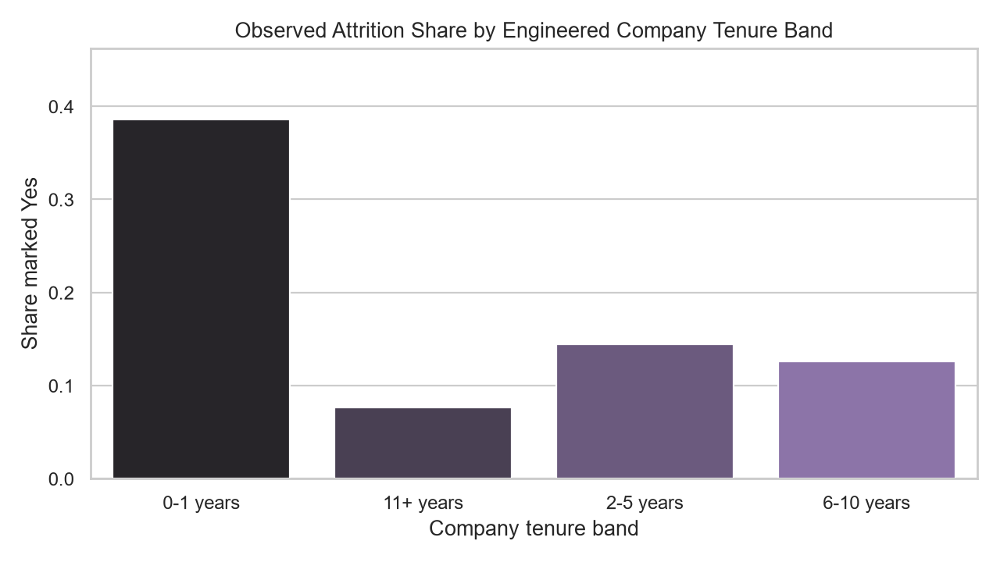

# Data Preprocessing, Feature Engineering & Machine Learning Pipeline

## Project overview
This Task 2 project prepares the IBM HR Analytics Employee Attrition & Performance sample for later modeling. It validates and cleans records, performs feature engineering, demonstrates encoding and scaling, diagnoses outliers, and builds a reusable scikit-learn preprocessor. **No predictive model is trained.** `Attrition` remains a separate target and is excluded from every feature transformation.

## Dataset and source
The source CSV contains 1,470 employee records and 35 columns. The dataset is a fictional IBM HR sample distributed through [Kaggle](https://www.kaggle.com/datasets/pavansubhasht/ibm-hr-analytics-attrition-dataset), with a repository mirror used to obtain the CSV. It is a fixed learning dataset, not a representative real-world workforce census.

## Data-quality assessment and cleaning
Before cleaning: 1,470 rows × 35 columns; 0 missing cells; 0 exact duplicate rows. The cleaning routine trims text, canonicalizes target values, converts numeric strings only when all observed values parse, removes 0 exact duplicate rows, and drops 0 rows with missing target labels. Result: 1,470 rows × 35 columns and 0 missing cells. No feature imputation was necessary on this source. The reusable pipeline nevertheless includes numeric median and categorical most-frequent imputers, learned on training data only.

## Target and split
The target balance is 83.88% `No` and 16.12% `Yes`. The reproducible split uses 1,176 training rows and 294 test rows (80/20, random state 42, stratified by `Attrition`). Class counts: train {'No': 986, 'Yes': 190}; test {'No': 247, 'Yes': 47}.

## Feature engineering, encoding, and scaling
Two deterministic features are added: `CareerStage` (age bands) and `CompanyTenureBand` (company-tenure bands). They use only row values and can be recreated for future records. `EmployeeNumber` is excluded as an identifier. The pipeline identifies 23 numeric and 9 categorical inputs after feature engineering, excluding ['EmployeeNumber', 'EmployeeCount', 'Over18', 'StandardHours'].

The encoding exercise compares LabelEncoder and OneHotEncoder on the same nominal `BusinessTravel` training feature. Label codes impose an artificial order, so the production preprocessor uses OneHotEncoder with `handle_unknown='ignore'`. The target is kept separate. StandardScaler and MinMaxScaler are compared on training-set `MonthlyIncome`; the saved numeric pipeline uses median imputation, train-fitted IQR capping for continuous values, and StandardScaler. Categorical inputs use most-frequent imputation and one-hot encoding.

## Outlier assessment
The 1.5×IQR diagnostic flags values for review; it does not establish that a value is erroneous. The table below is computed from the real source values. The cleaned CSV retains all eligible rows. In the fitted reusable transformation, IQR fences are learned from training rows and cap continuous columns; low-cardinality ratings/codes are not capped.

| Numeric feature | IQR-flagged rows | Percentage |
|---|---:|---:|
| TrainingTimesLastYear | 238 | 16.19% |
| PerformanceRating | 226 | 15.37% |
| MonthlyIncome | 114 | 7.76% |
| YearsSinceLastPromotion | 107 | 7.28% |
| YearsAtCompany | 104 | 7.07% |
| StockOptionLevel | 85 | 5.78% |
| TotalWorkingYears | 63 | 4.29% |
| NumCompaniesWorked | 52 | 3.54% |

## Reusable, leakage-safe preprocessing
The `Pipeline` and `ColumnTransformer` are fitted using `X_train` only. The held-out `X_test` is transformed using the fitted object without refitting. The transformed training matrix has shape [1176, 58]; the test matrix has shape [294, 58]. Unknown categorical labels are safely ignored as all-zero indicators within their encoded field. The fitted artifact is `models/preprocessor.pkl`, serialized with Joblib. Reload equivalence and unseen-category transformation are verified in the notebook and tests.

## Findings and interpretation
- The observed class imbalance is substantial (16.12% attrition marked Yes), so Task 3 evaluation should use suitable stratified validation and metrics that do not rely on accuracy alone.
- The plot of observed attrition shares across tenure bands is descriptive. Differences in this sample do not establish that tenure causes attrition.
- Numeric IQR flags are screening indicators and may reflect valid extreme values; records were not removed based solely on an outlier rule.
- Scaling changes feature ranges, not the underlying employee records. StandardScaler is a reusable starting point; the final choice depends on the Task 3 estimator and validation.

## Visualizations

### Figure 1. Counts of the Attrition target classes.

### Figure 2. Monthly income distributions by target class; points beyond whiskers are potential outliers.

### Figure 3. Numeric features with the highest 1.5×IQR flag counts.

### Figure 4. Training-only StandardScaler and MinMaxScaler transformations for MonthlyIncome.

### Figure 5. Observed attrition share by engineered company-tenure band.

## Limitations and conclusion
This dataset is fictional, cross-sectional, and static; it may not represent actual employees, contemporary workplaces, or other organizations. Associations are descriptive and do not establish causation. The IQR rule is a conventional screening choice, and the clipping policy should be evaluated with the later model. The artifact prepares features only; no predictive model is fitted. In Task 3, fit the preprocessor within each cross-validation/model-selection fold to keep validation data from influencing learned transformations.

## Reproducibility and references
- Raw CSV: `data/raw/employee_attrition.csv`; cleaned export: `data/processed/employee_attrition_clean.csv`.
- Split membership and class counts: `data/processed/train_test_split_manifest.json`.
- Fitted pipeline: `models/preprocessor.pkl`.
- Source: [IBM HR Analytics Employee Attrition & Performance dataset listing](https://www.kaggle.com/datasets/pavansubhasht/ibm-hr-analytics-attrition-dataset). Data are presented as a fictional IBM sample; this analysis makes no claims about IBM employees.
- Software: pandas, NumPy, scikit-learn, Matplotlib, Seaborn, Joblib.
